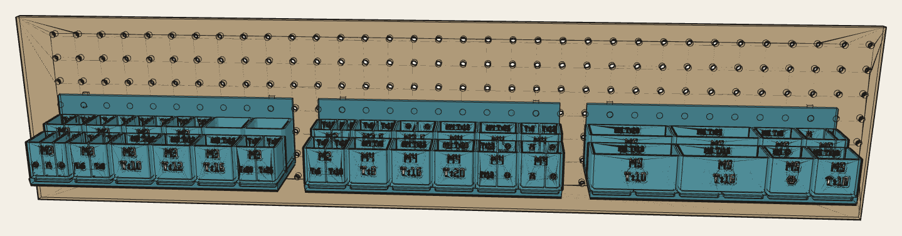

# Gridfinity fastener racks

Three 6 × 2 Gridfinity racks for 1 inch pegboard, holding 47 lines of M2–M5 stainless fasteners in
32 bins. Bins carry flush two-colour [Fillaprint](https://github.com/thereprocase/double-bead) labels:
thread size, a side-profile symbol, a dimension line and the length.

**Site, renders and downloads:** https://thereprocase.github.io/gridfinity-fastener-racks/



## Files

| Path | Contents |
|---|---|
| `docs/downloads/<rack>-bins.3mf` | One plate of bins per rack; labels are parts on filament 2 |
| `docs/downloads/<rack>-shell.3mf` | The rack: Gridfinity pockets, back panel, pegboard hooks |
| `src/layout.py` → `racks.json` | Which part goes in which compartment, with fill estimates |
| `src/icons.py` → `icons.json` | Fastener symbols, checked to Fillaprint's two-line stroke and gap rule |
| `src/build.py` | FreeCAD build of racks, bins and label inlays |
| `src/make_3mf.py`, `src/site.py` | 3MF plates and this site |

## Build

```sh
cd src
python3 layout.py
python3 icons.py          # needs shapely
flatpak run --command=FreeCADCmd org.freecad.FreeCAD -c "exec(open('build.py').read())"
python3 make_3mf.py dist
python3 site.py
```

## Licence

CC BY 4.0. Fillaprint is under the SIL Open Font License 1.1 (`src/fonts/OFL.txt`).
